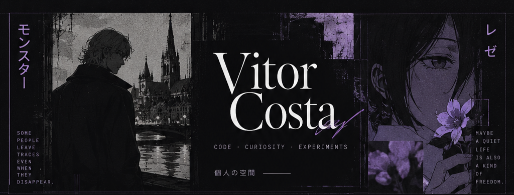
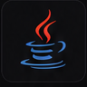
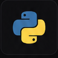

  

 

### 01 / Sobre · About `自己紹介`

**PT** — Este é meu espaço para guardar projetos da faculdade, estudos e experimentos que nascem de ideias aleatórias. Nem tudo precisa ter um propósito além da curiosidade.

**EN** — This is my space for university projects, things I'm learning, and experiments born from random ideas. Not everything needs a purpose beyond curiosity.

 

### 02 / Tecnologias · Technologies `技術`

NO MEU DIA A DIA / WHAT I WORK WITH

  &nbsp;
  

ESTUDANDO / CURRENTLY LEARNING

  &nbsp;
  &nbsp;
  

FERRAMENTAS / TOOLS

  &nbsp;
  &nbsp;
  

 

### 03 / Um pensamento · A little thought `余韻`

> *“Nem toda fuga é sobre ir embora.”*  
> *“Not every escape is about leaving.”*

Uma referência sutil à Reze, de Chainsaw Man. / A subtle nod to Reze from Chainsaw Man.

 

### 04 / Por aí · Find me `連絡先`

**Twitter / X** — [@yorucrf](https://x.com/yorucrf)  
**Discord** — `@yorucrf`

---

  VITOR COSTA &nbsp;·&nbsp; 個人の空間 &nbsp;·&nbsp; PERSONAL SPACE

